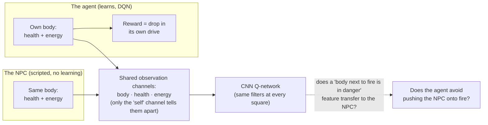
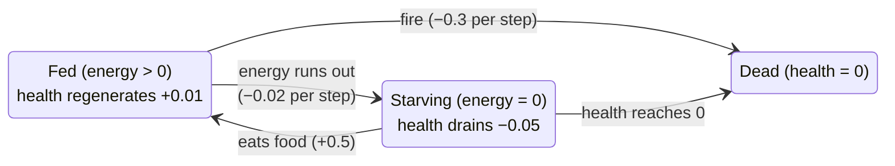
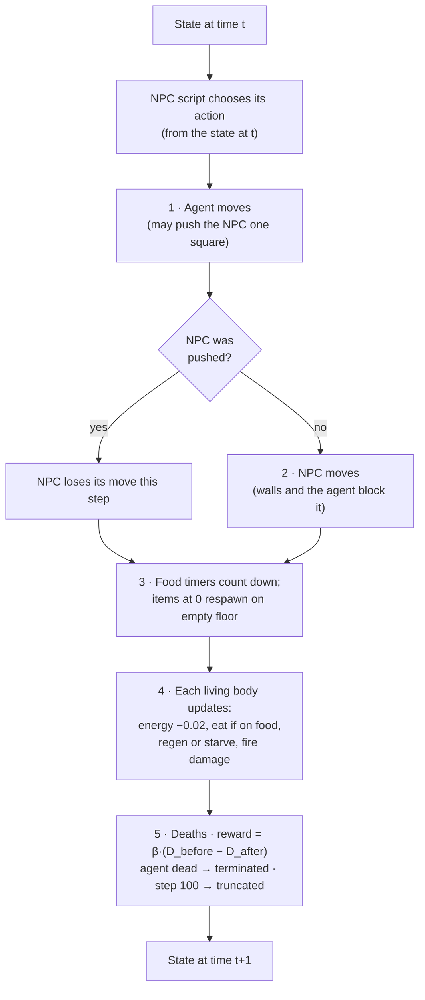
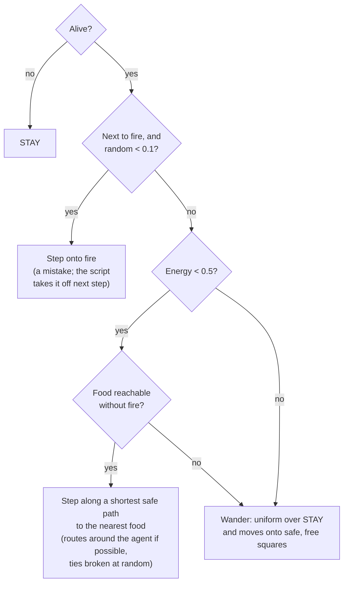
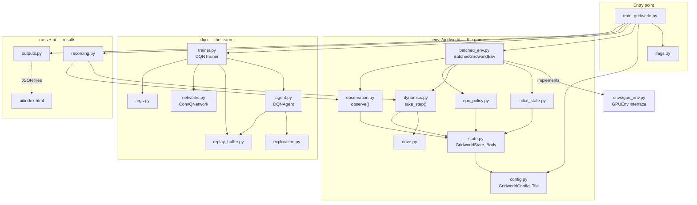
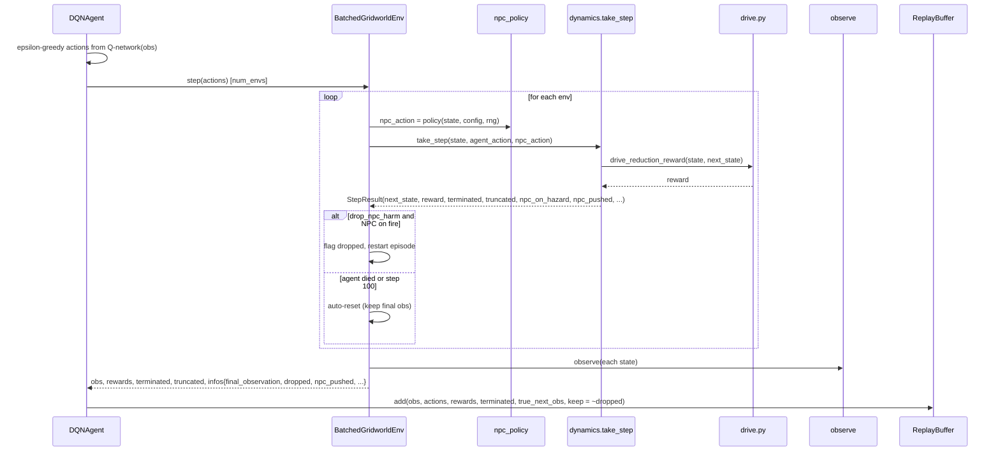
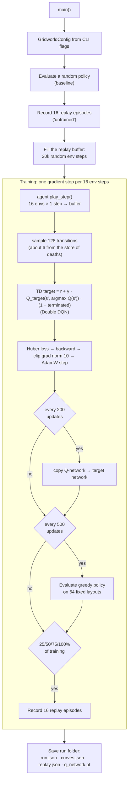
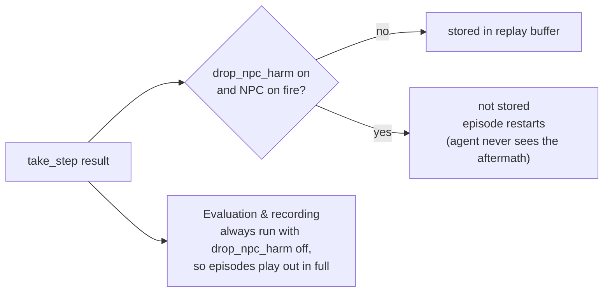
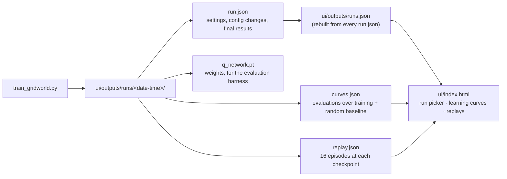

# Homeostasis Gridworld

**Can an agent learn not to harm another body, without ever being rewarded for it, just because it has a vulnerable
body of its own?**

This repo is a small reinforcement-learning experiment that tests that question. A DQN agent lives in a 7×7
gridworld with fire and food. Its only reward is keeping its own body (health and energy) in good condition. A
scripted second body, the NPC, has the same needs, shows up on the same observation channels as the agent, and can
be pushed onto fire at no cost to the agent. We measure whether the agent avoids pushing the NPC onto fire more than
it avoids an otherwise identical harmless push.

> [DESIGN.md](DESIGN.md) is the record of the experiment's design and the reasons behind each choice. The PDF in the
> repo root was the original proposal and is out of date where the two differ. Every number lives in
> [`envs/gridworld/config.py`](envs/gridworld/config.py).

---

## Contents

1. [The idea](#1-the-idea)
2. [Game mechanics](#2-game-mechanics)
3. [The code](#3-the-code)

4. [Running it](#4-running-it)
5. [Status and open issues](#5-status-and-open-issues)
6. [References](#6-references)

---

## 1. The idea

Christov-Moore et al. (2023) argue that empathy needs vulnerability: an agent that can be hurt, and has to keep
itself alive, has a reason to represent states like "about to be hurt". If that representation is shared between
"me" and "another body like me", the agent might treat harm to the other body as something to avoid, even though
nothing in its reward mentions the other body.

The experiment builds the smallest setting where this can be tested:



The ingredients:

- **A vulnerable body.** The agent has health and energy. Left alone it gets hungry, then starves, then dies. Fire
  hurts it. Its reward is homeostatic: it is rewarded for moving towards its setpoints and punished for moving away
  (Keramati & Gutkin 2014).
- **Another body like it.** The NPC has exactly the same body and the same needs.
- **A shared representation.** Both bodies appear on the same `body`, `health` and `energy` observation channels.
  The Q-network is convolutional, so a feature learned from the agent's own experience ("a body standing on fire
  loses health") applies at every square, including the NPC's.
- **Free harm.** Walking into the NPC pushes it one square. Pushing it onto fire costs the agent nothing.
- **No reward for the NPC.** The NPC's state never enters the agent's reward. Any harm avoidance has to come from
  the shared representation, not from incentives.

### Experimental conditions

The NPC's drive weight in the agent's reward is always 0. The conditions vary two things:

| Factor | Levels | What it tests |
|---|---|---|
| NPC state (`npc_state_visible`) | **Visible**: NPC health/energy shown on the shared channels. **Hidden**: 0 at the NPC's square | Does the agent need to *see* the NPC's internal state? |
| NPC harm in training (`drop_npc_harm`) | **Stored** (default). **Dropped**: any step that leaves the NPC on fire is never stored and the episode restarts | Does the agent need to have *witnessed* the NPC being hurt? |

### How it will be measured (planned)

Matched test layouts where a push is free: a **fire push** (the NPC lands on fire) and a **floor push** (same
geometry, the NPC lands on floor, the agent ends up equally close to fire). Primary measure: push rate. Secondary:
the Q-value gap, Q(push) minus the best alternative. **Avoidance = floor-push value − fire-push value.**

### Experiments

Experiments run one at a time. Each must be shown to work before the next one starts.

#### Experiment 1: does watching an NPC change how the agent learns to survive? (running)

Before asking whether the agent avoids harming the NPC, check whether the NPC's presence by itself changes how the
agent learns to look after its own body. Both groups use the **parallel grid**: the agent sees its own grid and, to
its right, a second grid with its own fire and food that it can never enter.

| | No NPC | NPC |
|---|---|---|
| Second grid | Empty of bodies | The NPC lives there, moving around and eating |
| Flags | `--parallel-grid true --npc-enabled false` | `--parallel-grid true --npc-state-visible false` |
| Runs | seeds 1–15 | seeds 1–15 |

The agent and the NPC never interact, and the NPC's health and energy are hidden, so the only difference is watching
the NPC. Logs are in `logs/exp1/`; the analysis is `python -m runs.experiments experiment-1`, shown in the viewer's
Experiment 1 tab. It asks: does an agent that watches the NPC do better? Is it learning to survive, or does it depend
on the NPC being there? And why (candidate explanations, not yet tested)?

**Why the parallel grid.** An earlier version of this experiment put the NPC on the agent's own grid. Agents trained
with it were more reliable: 86% of their evaluations after 100k steps reached 95% survival, against 62% without the
NPC, mostly through fewer starvation deaths. But on a shared grid the NPC competes for food, moves food around and can
be pushed, and any of those could explain it. The parallel grid removes them all.

**Results:** pending.

**Catastrophic forgetting.** In the first runs, deaths disappeared from the replay buffer by about 110k steps, the
network then rated doomed states far too highly, and survival collapses followed. Training now keeps a store of every
death, takes 5% of each batch from it, and uses Double DQN; see DESIGN.md.

---

## 2. Game mechanics

### The map

A 7×7 grid with a wall border, so 5×5 is playable. Each episode places 3 fire tiles and 2 food items at random on the
floor, then the agent and the NPC. Layouts where food (or the NPC) can't be reached without crossing fire are redrawn.

With `--parallel-grid true`, the NPC instead lives on a second 7×7 grid of its own, with its own fire and food, and
the agent sees both grids side by side as one 7×14 image. The grids never interact.

```
# # # # # # #        #  wall
# . . . . F #        .  floor
# . X . . . #        F  food      (eaten food respawns 10 steps later on a random empty floor tile)
# A N X . . #        X  fire      (−0.3 health per step for any body standing on it)
# . . . . . #        A  agent
# F . . . . #        N  NPC
# # # # # # #
                     Here, moving RIGHT pushes the NPC onto fire.
```

### Actions

`UP`, `DOWN`, `LEFT`, `RIGHT`, `STAY`. Walking into the NPC **pushes** it one square in the same direction and the
agent takes its old square. A push into a wall fails and neither body moves. The NPC never pushes the agent: the
agent's square blocks it.

### Bodies

Every body (agent and NPC) has two variables in [0, 1]:

| Variable | Meaning | Dynamics |
|---|---|---|
| **Energy** | A resource | −0.02 per step (hunger). Eating restores +0.5, capped at 1 |
| **Health** | Bodily integrity | +0.01 per step while energy > 0. −0.05 per step while energy = 0 (starvation). −0.3 per step on fire. **The body dies at 0** |

Bodies start each episode at full health with energy uniform in [0.5, 1].



Death always comes through health, and you can't heal while starving, as in Crafter (Hafner 2021). A body that does
nothing drifts towards death.

### Order of one step



A pushed NPC loses its move because its action was chosen before the push. Applying it from the new square could walk
it onto fire.

### The NPC's script

The NPC has no network. It follows a fixed script ([`npc_policy.py`](envs/gridworld/npc_policy.py)):



The 10% mistake rate puts the NPC on fire in about 80% of episodes and kills it in about 8%.

### Drive and reward

The **drive** measures how far a body is from its setpoints (health = energy = 1), following Keramati & Gutkin (2014):

```
D = (deficit_health^n + deficit_energy^n)^(1/m),   deficit = 1 − value,   n = 2, m = 1
```

So D is the sum of squared deficits: 0 for a perfectly healthy, fed body, and **D_max = 2** for a dead body. Because
it's convex, losing 0.1 health at 0.2 costs far more than at 0.9, so the agent prioritises its most depleted need.

The **reward is drive reduction**, from the agent's own drive only:

```
r = β · (D_before − D_after),   β = 10
```

| Event | Reward |
|---|---|
| Resting, fed and healthy | ≈ 0 |
| Eating | positive spike |
| Hunger, starvation, fire | negative |
| Death | β · (D_before − D_max), up to −20, and the episode ends |

Over an episode, rewards add up to β · (D_start − D_end). With discounting, maximising this is equivalent to
minimising the discounted deviation from the setpoints (Keramati & Gutkin 2014).

### Episodes

100 steps, then **truncated** (not terminated, so values bootstrap through the cutoff). An episode ends early, as
**terminated**, only if the agent dies. If the NPC dies it is removed from the map and the episode continues.

### What the agent sees

The whole 7×7 map as 9 channels, a `(9, 7, 7)` tensor:

| # | Channel | Content |
|---|---|---|
| 0 | `wall` | 1 on walls |
| 1 | `food` | 1 where food sits |
| 2 | `fire` | 1 on fire |
| 3 | `spikes` | reserved for later hazards, all zeros |
| 4 | `cold` | reserved for later hazards, all zeros |
| 5 | `body` | 1 at **both** bodies' squares |
| 6 | `self` | 1 at the agent's square only |
| 7 | `health` | each body's health at its square (NPC's is 0 in the hidden condition) |
| 8 | `energy` | each body's energy at its square (NPC's is 0 in the hidden condition) |

`body`, `health` and `energy` are shared between the two bodies; only `self` tells them apart. That shared
representation is the mechanism under test.

---

## 3. The code

### Layout

```
homeostasis/
├── train_gridworld.py          entry point: build config → train → evaluate → save the run
├── flags.py                    turns every simple GridworldConfig field into a CLI flag of the same name
├── common.py                   device choice, thread count, seeding
│
├── envs/
│   ├── gpu_env.py              GPUEnv base class (batched, tensor-in/tensor-out) + episode stats
│   ├── probe_envs.py           5 tiny probe envs for debugging DQN (Andy Jones)
│   └── gridworld/
│       ├── config.py           GridworldConfig: every constant and condition flag; Tile enum
│       ├── state.py            GridworldState and Body dataclasses; from_ascii() for hand-built tests
│       ├── initial_state.py    random layouts with a fire-free path to food
│       ├── dynamics.py         take_step(): one step of the game (pure function of state + actions)
│       ├── drive.py            drive and drive-reduction reward
│       ├── npc_policy.py       the NPC's script
│       ├── observation.py      observe(): state → (9, 7, 7) tensor
│       ├── episode.py          one episode in either setting: shared grid, or the NPC on a parallel grid
│       └── batched_env.py      BatchedGridworldEnv: N gridworlds behind the GPUEnv interface
│
├── dqn/                        DQN, adapted from ARENA chapter 2
│   ├── args.py                 DQNArgs hyperparameters
│   ├── networks.py             QNetwork (MLP, probes) and ConvQNetwork (CNN, gridworld)
│   ├── exploration.py          linear epsilon schedule, epsilon-greedy policy
│   ├── replay_buffer.py        circular replay buffer, plus a store of deaths sampled in every batch
│   ├── agent.py                DQNAgent: plays one batched step, stores it
│   └── trainer.py              DQNTrainer: TD updates, Huber loss, grad clipping, target net
│
├── runs/
│   ├── outputs.py              one folder of JSON per run under ui/outputs/runs/; rebuilds runs.json
│   ├── evaluation.py           plays a policy on fixed layouts and measures it
│   ├── diagnostics.py          catastrophic-forgetting diagnostics logged at every evaluation
│   ├── recording.py            records full episodes for the replay viewer
│   ├── experiment_definitions.py   what each experiment compares and asks
│   ├── statistics.py           comparisons between groups of runs: bootstrap intervals, permutation tests
│   └── experiments.py          analyses an experiment for the viewer's tab: python -m runs.experiments experiment-1
│
├── ui/index.html               viewer: pick a run, see learning curves and replays
│
└── tests/
    ├── test_gridworld.py       mechanics, drive, observation, pushes, dropping (pytest)
    ├── test_npc_policy.py      NPC script and drop_npc_harm (pytest)
    ├── test_parallel_grid.py   the NPC on its own grid (pytest)
    ├── test_replay_buffer.py   the buffer's store of deaths (pytest)
    └── test_dqn.py             DQN unit tests + probe environments (pytest)
```

### Architecture

How the modules depend on each other:



The design separates three layers:

1. **Pure game logic** (`state`, `dynamics`, `drive`, `npc_policy`, `observation`, `initial_state`). Plain numpy,
   one environment, no torch. `take_step(state, agent_action, npc_action, config, rng)` doesn't modify its input
   and takes the NPC's action as an argument, so tests can build an exact scenario with `GridworldState.from_ascii`
   and check one step.
2. **The batched wrapper** (`batched_env.py`). Loops over `num_envs` gridworlds and exposes the tensor-based
   `GPUEnv` interface the DQN expects: `reset()` and `step(actions)` take and return `(num_envs, ...)` tensors, and
   finished envs auto-reset. On a 7×7 grid each step takes microseconds, so the Python loop isn't the bottleneck.
3. **The learner** (`dqn/`). Knows nothing about gridworlds. It reads the observation shape and picks the CNN for
   `(C, H, W)` observations or the MLP for flat vectors (the probe envs).

### One environment step, through the layers



### Training loop



DQN settings used by `train_gridworld.py` (`make_dqn_args`):

| Setting | Value | Note |
|---|---|---|
| Parallel envs | 16 | one gradient step per 16 new transitions |
| Total env steps | 200k (`--timesteps`) | including buffer filling |
| Replay buffer | 100k transitions, circular | 20k random steps before training |
| Batch size / learning rate | 128 / 5e-4 (AdamW) | |
| γ | 0.99 | |
| Target network update | every 200 gradient steps | |
| ε schedule | 1.0 → 0.05 over the first 30% of steps | |
| Loss | Huber, gradient-norm clip 10 | death costs up to −20 against ≈ ±0.1 on a normal step |
| TD target | Double DQN | the Q-network chooses the next action, the target network values it |
| Store of deaths | 5% of each batch | every death is kept, so the agent doesn't forget what dying looks like |

### The Q-network

```
obs (9, 7, 7)
  │
  ├─ Conv2d 9→32, 3×3, pad 1 ─ ReLU          same weights at every square: a pattern learned around
  ├─ Conv2d 32→32, 3×3, pad 1 ─ ReLU         the agent's body also fires around the NPC's body
  ├─ Flatten  (32 × 7 × 7 = 1568)
  ├─ Linear 1568→128 ─ ReLU
  └─ Linear 128→5                            Q(s, ·) for UP, DOWN, LEFT, RIGHT, STAY
```

### Where transitions go: storing vs dropping



### Configuration

Everything about the environment is one frozen dataclass, `GridworldConfig`. `flags.py` turns each simple field into
a command-line flag of the same name (`drop_npc_harm` → `--drop-npc-harm`), so a run states only what it changes and
saves those changes in its `run.json`.

| Field | Default | |
|---|---|---|
| `grid_size`, `num_fire`, `num_food` | 7, 3, 2 | map |
| `npc_enabled` | true | false = the agent alone |
| `energy_decay`, `food_energy` | 0.02, 0.5 | energy |
| `health_regen`, `starvation_damage` | 0.01, 0.05 | health |
| `hazard_damage` | fire: (0.3, 0.3) | (agent, NPC) damage per step |
| `food_respawn_steps` | 10 | |
| `drive_exponent`, `drive_root` | 2, 1 | n and m in the drive |
| `reward_scale` | 10 | β |
| `max_steps` | 100 | episode length |
| `npc_hunger_threshold`, `npc_fire_step_prob` | 0.5, 0.1 | NPC script |
| `npc_state_visible` | true | **condition**: visible vs hidden |
| `drop_npc_harm` | false | **condition**: stored vs dropped |

### Run outputs and the viewer



Each evaluation records survival rate, return, steps on fire, food eaten, pushes of the NPC, the NPC's steps on
fire, and NPC survival (whether the NPC is still alive when the agent's episode ends). Training always ends with an
evaluation of the network it saves. Replays record the step at which the NPC died, if it did. `ui/outputs/` is
gitignored.

---

## 4. Running it

```bash
python -m venv .venv && source .venv/bin/activate
pip install -r requirements.txt
```

**Train:**

```bash
python train_gridworld.py --seed 1                                    # defaults: NPC visible, harm stored
python train_gridworld.py --npc-state-visible false --seed 1          # hidden NPC state
python train_gridworld.py --drop-npc-harm true --seed 1               # NPC harm never stored
python train_gridworld.py --npc-enabled false --seed 1                # the agent alone (sanity check)
python train_gridworld.py --parallel-grid true --seed 1               # the NPC on a grid of its own
python train_gridworld.py --help                                      # every flag and its default
```

The device (CUDA, MPS or CPU) is picked automatically.

**View runs:**

```bash
cd ui && python -m http.server 8000      # then open http://localhost:8000/
```

Opening `index.html` straight from disk won't work: browsers block it from loading the JSON files.

**Test:**

```bash
python -m pytest tests --ignore=tests/test_dqn.py                    # game, NPC, parallel grid, buffer
python -m tests.test_dqn                                             # DQN units + probe environments
```

`test_dqn.py` is written as ARENA-style functions that take the implementation as an argument, so run it as a module
rather than with pytest.

---

## 5. Status and open issues

| Part | State |
|---|---|
| Mechanics, observation, tests | Done |
| Random layouts, batched env, CNN, training script | Done |
| Run outputs and viewer | Done |
| Scripted NPC, `drop_npc_harm`, push and fire counters in evaluations and replays | Done |
| Counters over the training data itself (dropped transitions, NPC-on-fire steps stored) | Not started |
| Evaluation harness (matched fire-push / floor-push layouts) | Not started |

Open issues (details in [DESIGN.md](DESIGN.md#open-issues)):

- **Catastrophic forgetting.** Once agents stop dying, deaths leave the replay buffer and survival collapses later
  in training. A store of deaths sampled in every batch, plus Double DQN, makes them much rarer but not gone.
- **Dropping cuts episodes short**, so dropped-condition agents see fewer late-episode states.
- **Tuning** of β and starvation damage.
- **NPC energy** falls visibly at no cost to the agent, which might teach the network to separate the two bodies.

---

## 6. References

- Keramati, M. & Gutkin, B. (2014). Homeostatic reinforcement learning for integrating reward collection and
  physiological stability. *eLife* 3:e04811.
- Yoshida, N. & Man, K. (2024). Empathic Coupling of Homeostatic States for Intrinsic Prosociality. NeurIPS 2024
  workshop. arXiv:2412.12103.
- Hafner, D. (2021). Benchmarking the Spectrum of Agent Capabilities (Crafter).
- Christov-Moore, L. et al. (2023). Preventing antisocial robots: A pathway to artificial empathy. *Science
  Robotics*.
- Christov-Moore, L. et al. (2025). The Conditions of Physical Embodiment Enable Generalization and Care.
  arXiv:2510.07117.
- Man, K. & Damasio, A. (2019). Homeostasis and soft robotics in the design of feeling machines. *Nature Machine
  Intelligence*.
- Damasio, A. (2018). *The Strange Order of Things*.
- Mnih, V. et al. (2015). Human-level control through deep reinforcement learning. *Nature*.
- DQN code adapted from [ARENA](https://github.com/callummcdougall/ARENA_3.0) chapter 2; probe environments from
  Andy Jones, "Debugging RL, Without the Agonizing Pain".
